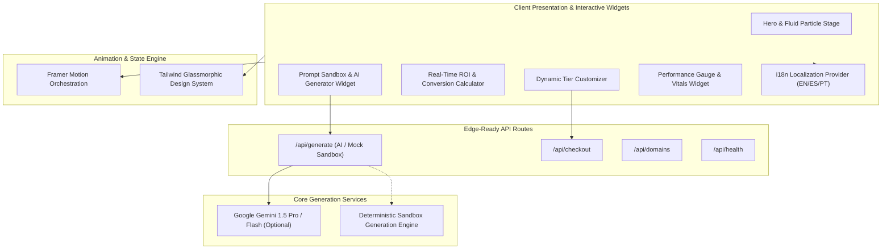

# Doxa Studio — High-Conversion SaaS Platform & Interactive Simulation Engine

[](https://nextjs.org/)
[](https://www.typescriptlang.org/)
[](https://tailwindcss.com/)
[](https://www.framer.com/motion/)
[](https://opensource.org/licenses/MIT)

> **High-Conversion Digital Agency Platform & Interactive Simulation Engine.**  
> Built with Next.js App Router, Framer Motion staggered animations, dark-glassmorphism design system, and multi-language localization (EN / ES / PT).

---

## 🏗️ System Architecture



---

## 🌟 Interactive Features & Technical Highlights

### 1. Real-Time Site Generator Sandbox
* **Instant Visual Synthesis**: Enter any product concept or business domain to instantly render a complete landing page structure, color palette, section layout, and edge deployment preview URL.
* **Zero-Config Resilient Fallback**: Designed with an automated fallback to the internal mock generation engine when no external API key is supplied, ensuring seamless offline and portfolio demonstration.

### 2. Interactive ROI & Business Logic Calculators
* **Dynamic Conversion Modeling**: Sliders dynamically compute projected monthly conversions, revenue uplift, and payback duration based on current site traffic and target conversion rates.
* **Custom Plan Configurator**: Real-time slider recalculating upfront and ongoing retainer commitments across custom service tiers.

### 3. Native Multi-Language Architecture (i18n)
* **Zero-Flash Switching**: Instant client-side localization across English, Spanish, and Portuguese with pre-compiled dictionaries and persistent locale selection.

### 4. High-Performance Dark Glassmorphism Design
* **Optimized Animations**: Utilizes GPU-accelerated CSS transforms and Framer Motion spring physics with minimal layout shifts (CLS 0.00).

---

## 🚀 Quickstart & Local Setup

### Prerequisites
* **Node.js** >= 18.x

### 1. Clone & Install Dependencies
```bash
git clone https://github.com/apollos-mint/doxa-saas-studio.git
cd doxa-saas-studio
npm install
```

### 2. Configure Environment (Optional)
```bash
cp .env.example .env.local
```
*(Leave `GEMINI_API_KEY` empty to utilize the built-in deterministic sandbox generator).*

### 3. Run Development Server
```bash
npm run dev
```
Open [http://localhost:3000](http://localhost:3000) to view the application.

---

## 🌐 Production Deployment (Vercel)

Deploy with zero configuration on **Vercel**:
```bash
npx vercel --prod
```
The application builds cleanly via `next build` with all static pages pre-rendered.

---

## 👤 Author & Engineering Credits

* **Lead Engineer**: **Eduardo De Sousa**
* **Role**: Operations & Automation Lead | Lean Six Sigma Black Belt | Full-Stack Systems Builder
* **Portfolio**: [https://eduardodesousa.vercel.app](https://eduardodesousa.vercel.app)
* **LinkedIn**: [linkedin.com/in/eduardo-desousa](https://www.linkedin.com/in/eduardo-desousa/)

---

## 📄 License
This project is licensed under the MIT License — see the [LICENSE](LICENSE) file for details.
